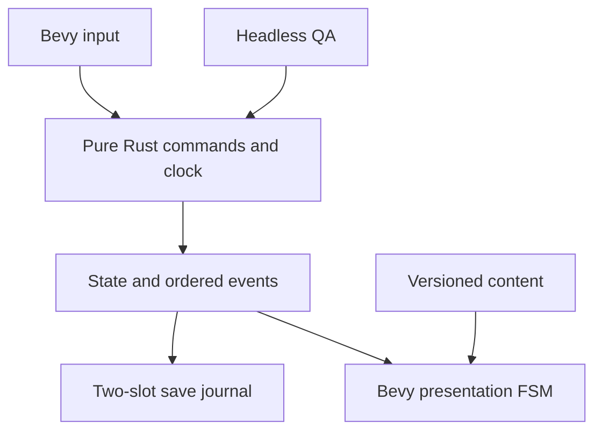

# Architecture

> **Screen audit supersession (2026-10-19 UTC):** Current main uses save schema7 (forge-core/src/save.rs), not the historical schema4 below. #106 approves default indoor960×180 and persistent lower180 during960×540 management. See the audit for proposed viewport/identity/party contracts; no runtime changes are made by that document. [Current audit](docs/design/AUDIT_REPORT.md).

Bevy 0.20.0 owns desktop windows, input, rendering, assets and presentation. Pure Rust owns game rules from the first implementation. Foundation is production repository code, not a throwaway POC.

## Workspace boundaries

| Path | Responsibility | Must not own |
|---|---|---|
| `crates/forge-core` | command/state/event contracts, deterministic clock/RNG, local save journal, pure window geometry policy | Bevy, graphics, animation-triggered rewards |
| `crates/forge-content` | versioned asset manifest and geometry validation | runtime state |
| `apps/desktop` | Bevy adapter, native window, animation FSM, input, clock/persistence orchestration | duplicate economic rules |
| `crates/forge-qa` | headless reproducible scenario and simulation benchmark | assertions of native desktop behavior |
| `assets` | supplied originals and provenance manifest | gameplay state |

## Deterministic domain

Integer seconds and absolute due times make time-step partitioning stable. Craft completion precedes a sale at equal timestamps. A seeded xorshift state and monotonic event/command IDs are persisted. Commands are applied to a candidate state and committed only on success; duplicate successful command IDs are rejected. Inventory and gold use checked arithmetic. Domain state can run without a window or renderer.

Foundation includes one `iron_dagger`: 2 ore, 5 seconds, 12 gold sale, and a 4-gold purchase of 2 ore. Initial ore is 10. Visitor intervals of 18–30 seconds are **accelerated Foundation demonstration values**, not the 30–60-minute village request cadence. The first craft starts automatically; subsequent crafts are explicit C input. Typed FIFO production and the first farmer repair now share the workbench. Recurring village requests remain a content milestone.

Finished goods live in a finite showroom (`forge_core::showroom`): one item per slot, states empty / reserved / displayed / held. A job reserves its result slot atomically before any ore is consumed; a full showroom makes queued work wait without a second debit, and only displayed goods sell. Work stages (heating → hammering → quenching) are derived from the remaining work, so presentation can never run ahead of or replay the simulation. The chosen smith (`State.smith`) is appearance only. See [Forge Spaces](docs/system/FORGE_SPACES.md).

Sale rewards are committed before presentation. ENTER → WALK → INSPECT → PURCHASE → EXIT_WITH_ITEM is a visual reenactment of an already committed event. A high-water event ID suppresses duplicate visual enqueues. The same dagger image is used on the display and at the visitor's hand. Offline events are not replayed as a burst of NPC animations.

## Persistence and time

`Save` contains schema version 4 / content version 1, generation, wall-clock high-water timestamp, state, RNG and counters. Save directory is per-user through `directories`, with an OS file lock preventing simultaneous writers. Two independently valid slots alternate generations. Write temporary file → flush/sync → remove only the inactive destination slot → rename → sync directory on Unix. A crash leaves the previous valid slot. Load selects the highest valid generation; corrupt files are preserved. Both corrupt or future-format saves cause an explicit error instead of a reset. Schemas 1–3 migrate to schema 4: preserve paid dagger jobs, assign their work kinds, initialize the first farmer order, import the dagger stock into the showroom losslessly (excess becomes migration-only overflow that sells first) and leave the smith unchosen so the title asks once. Current-format missing order/work/showroom metadata is not reset. Newer schemas are refused by older builds. See [Village UI](docs/qa/VILLAGE.md) for transaction and map boundaries.

Resume processes at most 8 hours; backwards clock movement contributes zero seconds. Normal runtime uses monotonic elapsed time, including capped suspend gaps. Every whole simulation second and accepted command is persisted. A write failure pauses simulation and shows a status error. A crash can lose less than one uncommitted second, not a previously saved reward. Window preferences are non-critical and stored separately.

## Desktop policy

Ambient 960×180 and expanded 960×540 are configurable candidates in code. Expansion preserves bottom position, then clamps into the selected display. Always-on-top defaults off. Safe mode uses opaque clear color and decorations and refuses pass-through. macOS uses Bevy's PostMultiplied alpha mode; Linux uses PreMultiplied. Windows uses automatic alpha selection.

F8 gives a **10-second pass-through lease**. Esc can recover while focused; the lease expires without keyboard input. Ctrl+Alt+F8 is registered on the event-loop thread for global recovery. Registration failure is logged; the timed lease remains the independent fallback. Indefinite pass-through is intentionally unavailable. The app does not explicitly request foreground focus on events.

Windows uses GetMonitorInfoW work bounds; macOS uses NSScreen.visibleFrame on the main thread, matched against winit coordinates. A conservative inset is used only if native lookup is unavailable (including Linux). Placement saves monitor name/origin and physical rectangle. Disconnected-display and mixed-DPI behavior still require native qualification. No cross-platform capability is inferred from compilation.

## Rendering and QA

Supplied PNGs remain unchanged, nearest sampled with explicit atlas grids. The source images are high-resolution generated artwork; native scale/crispness and frame alignment require visual review. Management is a keyboard-accessible Foundation ledger, not the complete product UI.

Automatic tests cover deterministic replay, time partitioning, failed/duplicate commands, resource invariants, save/load/corruption, offline cap, locking, geometry/recovery and the headless presentation FSM. `--qa` isolates saves, waits for assets and advances presentation at fixed steps before capturing frame 180. CI builds all three OSes and retains portable packages and screenshot candidates. Reviewed golden-image approval and native desktop acceptance are separate from capture.

## Deferred scope

Map navigation and basic commerce are implemented. The first farmer sickle repair uses a typed shared FIFO, entrusted-order state, and exactly-once delivery settlement. See `docs/qa/FIRST-REPAIR.md`. Recurring commissions, 9 tool definitions, broader relations, feedback/research, expeditions and cards remain governed by `docs/`. No durability physics, combat, multiplayer, 60-weapon catalog or asset generator is introduced. Steam SDK, signing, notarization and store release are later release tasks.

## Forge spaces and player presentation

`apps/desktop/src/spaces.rs` shows the same `Session` as an exterior diorama (ambient window), a workshop and a showroom (expanded window). View choice, window mode and village navigation are separate states; hiding a view never stops or duplicates simulation. `crates/forge-npc/src/player.rs` consumes the characters' `atlas-manifest.json` and `animation.json` (trimmed sprites, pivots, stations, loop ranges, event markers) and `stations.rs` fixes the five-station floor plan; both are shared by the game and `npc-preview --character`. Event markers are sound/effect hooks only. The showroom UI uses shared `forge-ui` slots and nine-slice frames registered from supplied art in `assets/forge/spaces`.

## Shared NPC presentation

`crates/forge-npc` owns validated NPC clip catalogs, per-instance playback, face composition and socket-based prop attachment. Its Bevy plugin is shared by `apps/npc-preview` and the desktop game; it has no dependency on `forge-core`. The preview is a standalone developer executable with no simulation or save initialization. The game adapter in `apps/desktop/src/npc.rs` observes accepted live food purchase commands and reenacts the handoff without modifying economic state. Routine animation QA and focused game adapter QA remain separate. See [NPC Preview](docs/npc/PREVIEW.md).
