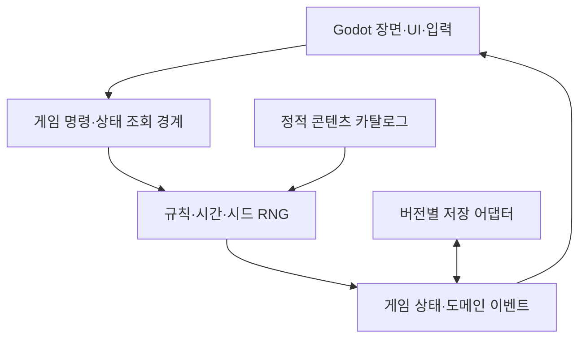

# Architecture

[프로젝트 개요](README.md) · [MVP 범위](docs/mvp/README.md)

이 문서는 구현 목표와 책임 경계를 정의한다. 현재 폴더·클래스·API가 구현되었다는 뜻은 아니다. **확정:** Godot 우선, Rust 점진 도입, 하단 플로팅 창. 그 밖의 구체적 모듈 구성과 시간 정책은 설계안이다.

## 1. 화면 구조

| 계층 | 책임 |
|---|---|
| 하단 대장간 | 대장장이 작업·방문객·진열품 등 지속되는 작은 장면 |
| 관리 패널 | 의뢰·제작·연구·인벤토리·관계 상세 |
| 마을 지도 | 장소 선택과 hover 컬러 오버레이 |
| 상점 패널 | 공통 프레임 안에서 건물별 탭·행동 표시 |
| 탐험 패널 | 모집·준비·파견·귀환 |
| 알림·장부 | 의뢰·피드백·완료 결과를 모아서 확인 |

관리 화면은 명시적 입력으로 열고 닫는다. 알림이 업무 중 포커스를 강제로 가져오지 않도록 한다. 상시 표시 크기, 확대 크기, 디스플레이 배율, 다중 모니터 위치는 POC에서 결정한다. 이전에 제안된 960×180 / 논리 320×60은 검증 후보이며 고정 규격이 아니다.

투명 영역과 조작 영역을 구분하는 입력 통과가 POC 목표다. 전체 창 통과로 복귀 버튼까지 잃는 상태를 피하고, 복귀 수단을 검증한다. 플랫폼별 지원은 시험 결과로 기록하며 일괄 지원을 가정하지 않는다.

## 2. 런타임 책임

Godot가 창·렌더링·애니메이션·오디오·입력·에셋을 소유한다. 도메인은 경제·제작·의뢰·관계·연구·탐험 규칙을 소유한다. UI 애니메이션 완료가 보상 지급을 결정해서는 안 된다.

초기에는 Godot 안에서 이 경계를 유지해 작동하는 경험을 우선 검증할 수 있다. Rust를 도입하면 해당 규칙의 유일한 소유자를 Rust로 옮긴다. GDScript와 Rust에서 같은 제작·보상 규칙을 동시에 유지하지 않는다.

## 3. Rust 도입 경계 — 설계안

| 모듈 후보 | 소유 책임 | 금지할 의존 |
|---|---|---|
| forge-core | 상태 전이, 콘텐츠 참조, RNG, 시간 계산 | Godot Node·렌더링·OS 창 API |
| forge-godot | Godot와 코어 간 명령·조회·이벤트 변환 | 별도의 경제·드롭 규칙 |
| Godot 앱 | 장면·상점·지도·입력·알림 | 저장 상태의 임의 직접 수정 |
| 저장 어댑터 | 직렬화·마이그레이션·원자적 교체 | 게임 가격·성공 판정 |

Godot 연결은 얇은 GDExtension 어댑터를 우선 검토한다. 범용 C ABI나 플랫폼별 네이티브 창 코드는 실제 필요가 검증된 뒤 추가한다. Rust 채택이 별도 자체 엔진 제작으로 확대되지 않도록 한다.

위 모듈 이름은 계획이며 실제 디렉터리가 아니다. Godot 버전·Rust 툴체인·바인딩 라이브러리 버전은 호환성 POC 후 고정한다.

## 4. 데이터와 상태

정적 정의와 진행 상태를 분리한다.

| 정적 정의 | 저장되는 진행 상태 |
|---|---|
| 아이템·레시피·상점·NPC·의뢰 템플릿 | 골드·재고·작업 큐·의뢰 인스턴스 |
| 연구·피드백·카드·탐험 지역 정의 | 경험·이해도·발견·관계·영구 해금 |
| 표시명·아트 참조·설명 | 다음 이벤트 시각·RNG 상태·처리한 보상 ID |

안정적인 문자열 ID로 참조한다. 표시명이나 이미지 경로를 저장 식별자로 사용하지 않는다. 콘텐츠 로딩 시 중복 ID·없는 참조·음수 가격·잘못된 수량·해금 순환을 검증한다. 데이터 형식은 JSON 등 단순 형식부터 검토하며 미정이다.

## 5. 명령과 원자성

명령 예: 의뢰 수락, 작업 등록, 재료 구매, 납품, 연구 시작, 탐험 파견·정산. 각 명령은 현재 상태를 재검증하고 한 번의 상태 전이로 반영한다.

- UI에 보인 가격보다 실제 명령 시점의 견적을 사용한다. 변경되면 재확인 가능한 결과를 반환한다.
- 재료 예약·아이템 생성·골드 차감·보상 지급을 중간 상태로 저장하지 않는다.
- 작업·의뢰·탐험·피드백에 고유 인스턴스 ID를 부여한다.
- 동일 완료 이벤트의 재처리로 보상이 중복되지 않도록 한다.
- UI에는 결과 스냅샷과 이벤트를 전달하며 코어 메모리의 가변 참조를 노출하지 않는다.

## 6. 시간과 방치 진행 — 제안 정책

**확정:** NPC 도구 내구도를 계산하지 않고 30~60분 간격의 시간 이벤트로 의뢰를 생성한다. 이는 마을 전체 의뢰 채널의 간격으로 해석하는 설계안이다. NPC마다 별도 생성하면 요청 빈도가 과도해진다.

권장 시간 모델은 다음과 같으며 최종 제품 정책은 POC 후 확정한다.

| 시계 | 용도 | 절전·종료 시 제안 |
|---|---|---|
| 활동 시간 | 의뢰 생성, 수락한 의뢰 납기 | 정지하여 부재 중 관계 손실 방지 |
| 제한된 경과 시간 | 제작·탐험 등 허용한 방치 진행 | 상한 내 따라잡기 |
| 실제 시각 | 마지막 저장·복귀·진단 | 보상 계산에 그대로 신뢰하지 않음 |

의뢰 간격과 납기 길이는 별개다. 미수락 의뢰에는 납기를 시작하지 않는 것을 기본 설계안으로 둔다. 완료된 작업의 납기 판정은 애니메이션이나 뒤늦은 확인 시점 대신 논리적 납품 시각으로 판정해야 한다.

복귀 처리 순서는 저장 검증 → 경과 시간 제한 → 시간순 작업·탐험 완료 → 피드백 대기 등록 → 결과와 마지막 시각 저장 → UI 요약이다. 보상은 완료 시각 순서로 처리하고 재진입 시 중복 정산을 막는다. 뒤로 이동한 시계는 경과 0으로, 과도한 전진은 정한 상한으로 제한한다. 상한 값은 미정이다.

오프라인 동안 수리 요청을 무한 생성하거나 복귀 즉시 연속 방문시키지 않는다. 난수 시드·다음 이벤트·대기 피드백을 저장해 재실행으로 요청을 다시 뽑는 현상을 줄인다. 다른 시간 정책을 선택하면 [관계](docs/system/NPC_RELATIONSHIP.md)와 [탐험](docs/system/EXPEDITION.md)도 함께 수정한다.

## 7. 저장

로컬 단일 플레이 저장을 기본 설계안으로 둔다. 서버·계정·온라인 거래는 초기 범위 밖이다.

저장에는 schema_version, content_version, 상태, 마지막 시각, RNG/스케줄러 상태, 정산 ID가 필요하다. 임시 파일 기록과 검증 후 교체하고 이전 정상 저장을 복구할 수 있게 한다. 실제 포맷과 백업 수는 미정이다. 오래된 저장은 명시적으로 마이그레이션하고 알 수 없는 콘텐츠 ID를 조용히 삭제하지 않는다.

## 8. POC와 검증

- 세 OS에서 창 위치·투명도·입력 통과·복귀·DPI·다중 모니터·절전 복귀를 직접 확인한다.
- CPU·GPU·메모리·백그라운드 사용량을 측정해 목표를 정한다. 측정 전 성능 수치를 보장하지 않는다.
- 도메인 검증은 가짜 시계·고정 시드로 제작/의뢰/피드백/정산을 재현한다.
- 저장 왕복·이전 버전·중간 실패·중복 정산·시계 역행을 검증한다.
- Rust 이전 시 같은 입력 로그에 대한 상태 결과로 기존 규칙과 동등함을 확인한다.
- Steam 배포 검증은 플레이 가능한 빌드 이후 단계다.

에셋 생성기는 런타임 필수 모듈이 아니다. 무료 3D 에셋을 활용하는 제작 파이프라인은 별도 연구로 두고, 라이선스·출처·수정 내역을 관리한다.
