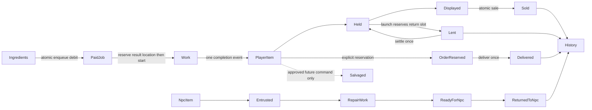

# Gameplay, identity and transactions

## Approved decision

One coherent forge → equip → expedition → learn → improve loop. Entrusted NPC tools never enter sale, salvage or unauthorized equipment. Research/practice is distinct from recipes and item quality. One smith performs one work action. Existing eight-hour offline cap remains unchanged by screen work.

## Existing implementation and gaps

| Surface | Source evidence | Qualification |
|---|---|---|
| atomic domain | `crates/forge-core/src/lib.rs:209` clones, dispatches, validates, commits; monotonic command IDs reject replay | implemented and unit tested; not a generic durable event journal |
| Farmer repair | `commission.rs:6`, `:45`, `:67` | one fixed order: 2 ore, 20 effective seconds, acceptance+7200 tick deadline; ready time ≤ deadline earns 24G/+5 favor; late 12G/+0; manual delivery |
| Chef | `progression.rs:179`, `assets/progression.json` | one 2-ore/20-second entrusted knife, 24G reward; no deadline/repetition/NPC-local relationship registry |
| work | `life.rs:7`, `:294` | typed enum, max 32 queued jobs; consumes materials on enqueue; first startable job bypasses capacity-blocked daggers, FIFO among runnable work |
| general goods | `craft.rs:10`, `showroom.rs:8`, `lib.rs:181` | Good::IronDagger and scalar counters, no item instance ID |
| expedition weapons | `expedition.rs:22`, `weapon.rs:231` | separate u64 IDs and armory (32); craftsmanship on hunting knives, permanent copies in progression |
| provenance | `progression.rs:91`, `:295` | first_item_id is from next_item_id, different namespace from expedition.next_weapon |
| sale | `lib.rs:360`, `weapon.rs:280` | visitor dagger 12G versus immediate crafted-knife sale 4G, different paths |
| salvage | workstation clip exists | no authoritative salvage command or return rules |

General inventory, armory, commission phases and historical first IDs cannot safely be joined by number. Weapon quality is deterministic, not RNG: `weapon.rs:116` derives force/penetration/interval/handling from material and approach; quality never multiplies damage. Queue stores only Plan and recomputes craftsmanship at finish, so the redesigned quote must state whether proficiency is snapshotted or may improve while waiting.

## Proposed resolution: minimum shared model

Prefer stable typed IDs and small registries in forge-core/content, not a full ECS inventory inside the pure domain. Keep stack counters for ore/timber/food; only non-stackable crafted/entrusted objects need instances. A competing per-screen DTO with independent ownership is rejected because atomic cross-screen exclusion and migration would remain impossible.

```text
ItemId(u64), ArchetypeId(string), RecipeId(string), WorkId(u64), OrderId(u64)
ItemInstance { id, archetype, origin, owner, location, provenance? }
owner = Player | Npc(NpcId)
location = Stored(SlotId) | Displayed(SlotId) | Entrusted(OrderId)
         | ReservedForOrder(OrderId) | Lent(ExpeditionId,MemberId) | Terminal(reason)
origin = Crafted(WorkId) | ImportedLegacy(source_namespace,old_id?) | Entrusted(OrderId)
WorkOrder { id, kind, terms_snapshot, paid_inputs, output_reservation, remaining_work }
kind = Craft(RecipeId,Plan) | Repair(OrderId,ItemId) | Research(NodeId) | Experiment(ExperimentId)
```

Use stable RackId/SlotId rather than a vector position: `showroom.rs:220` inserts upgrade slots and shifts following indices. Exactly one live location per item. Displayed/held/player equipment use the same ItemId; sale and delivery retire ownership while retaining an immutable history record. NPC ownership is a separate axis, so an entrusted repair cannot become a player-owned weapon merely by moving location.



Proposed commands: `QuoteCraft`, `QueueWork { recipe, plan, destination, expected_quote_version }`, `AcceptOrder`, `QueueOrder`, `DeliverOrder { order, item }`, `SetDisplay { item, slot }`, `HoldItem`, `LaunchParty`, `SellItem`. Quotes/selectors are pure functions, not mutating commands. All writes go through existing `State::command`; checked arithmetic and validation errors roll back IDs, stock, gold and events together. Domain failures return typed reasons; UI may not patch state to make a preview work.

Keep enqueue-time debit for MVP to preserve existing work semantics; store exact paid quantities in job. Alternative reserve-until-start requires a second stock accounting model with no current cancellation benefit. Proposed no active-job cancellation and no queue refunds until explicit rules are approved. Snapshot recipe/material/content version, cost, approach and proficiency at enqueue for stable quote/result; existing in-flight jobs retain legacy calculation version. Research eligibility is checked at enqueue and completion; knowledge is monotonic. Same second order: finish work → record knowledge/unlocks → finish combat → visitor decision; new commands receive the next transaction boundary. Do not let a sprite event decide a transaction.

### Capacity and migration, approval D05

Recommend one finite player-item capacity with reservations retained while lent, so a returning weapon always has its original slot. Entrusted tools use order capacity, not player sale slots. Display is a flag/location within that finite storage. Alternative separate 32-item armory can coexist under one ItemId but hides a second storage budget from the player. Existing saves may have 24 showroom items plus 32 armory items; migrate all into a non-selling overflow/legacy capacity allowance with exact counts, no forced sales or deletion. D05 must approve this capacity change before implementation. Preserve existing old showroom overflow policy for already-marked legacy stock, distinguish newly imported armory overflow.

Stage migrations with explicit version decoders from schema 7; do not choose a next version until integration branch is current. Deterministic ID map covers `(legacy_kind,old_id)` and old anonymous slots; do not synthesize craftsmanship/timestamps. Keep an old-ID alias table for battle snapshots and codex first records. A first_item_id with no true item link stays an historical local reference. Preserve paid active/queued work, command/event counters, stocks, smith, rules and two-slot recovery. Validate migrated totals before writing. Reject unknown future/current missing required fields; do not use serde defaults to erase missing authoritative records. Stable tagged versioned enums simplify explicit migration ([Serde representations](https://serde.rs/enum-representations.html)); representation alone does not validate gameplay invariants.

### Generic commissions, approval D02

`OrderTemplate { id,npc,kind,recipe_or_repair,eligibility,terms }` produces `OrderInstance { id,template_version,npc,terms_snapshot,phase,accepted_at,deadline_at,completed_at,delivered_at,settlement_id }`. Separate routine repeatable repair from special one-time narrative orders; NPC progress stores only delivered milestones, favor and eligible feedback IDs. Chef, Farmer, Leatherworker and Carpenter need real templates under #77; existing 9 signature tools / 3 shop unlocks remain broader content scope, not invented here.

Transitions: Offered → Accepted → Queued → Working → Ready → Delivered. Offered → Declined/Expired has no penalty. Accepted → Cancelled/Failed is allowed only by an approved policy, with one settlement. Late is an outcome field, not an automatic destruction of the customer's tool. Preserve Farmer's completion-time rule and old terms. Propose new routine late completion remains deliverable at reduced reward; no automatic repeat penalty each tick. For new relationships use NPC-local clamp 0–100, never global reputation; delta and price curve must be approved. Unaccepted orders never start deadlines. Snapshot reward/inputs/deadline when accepted.

Unresolved: docs propose paused-offline deadlines, but existing `Save::catch_up` advances the same tick used by Farmer deadlines. Options: (A) keep one capped simulation clock including offline, simple and deterministic; (B) add explicit active-time budget/deadline clock that pauses offline, friendlier but migration and suspend semantics required. Recommend A with completion-time adjudication for existing contracts; new-contract policy needs owner approval, not an inferred change. Deadline boundary is inclusive. No RNG gate for required starter requests.

Repeat scheduling: preserve approved 30–60 minute direction. Proposed one shared village channel, persisted next_due/seed, no auto-accept, cap 3 offered/2 accepted, no relationship penalty for ignored offers. Caps/distribution remain proposals. Prefer deterministic round-robin eligible NPC selection plus seeded interval; alternative weighted random NPC selection risks starving required content. Narrative starter orders bypass timer. Offline proposal produces at most enough offers to fill the cap, does not fabricate accepted failures or completed orders. Reliable recovery income still needs explicit resource-free or NPC-supplied-input recovery contract, because spending all resources can otherwise softlock; this is a product decision, not an implemented feature.

## Open decision

D02: deadline clock, late/failure/cancel deltas, routine terms/caps, shop restock and zero-resource recovery. D03: recipe/practice costs and new fabrication effects. D05: common capacity, history retention, legacy entitlements. These are real blockers for generalized screens; do not fill them with fixture cards. See issue ownership in IMPLEMENTATION_SEQUENCE.

## Explicitly excluded scope

No full RPG, global reputation, random mandatory discovery, marketplace, wear physics, enhancement cards, new salvage payouts, unapproved currency or automatic purchases. The audit does not change any numeric requirement or existing save.
