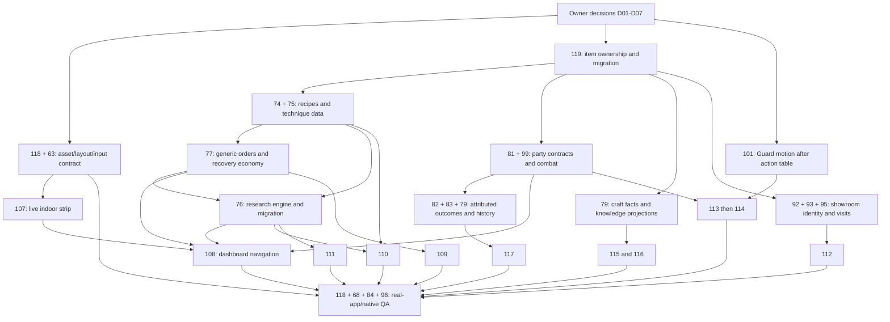

# Implementation readiness and dependency order

## Approved decision

#106 owns screen/UX, #58 shared UI, #72 progression/content/history, #73 expedition, #86 spaces/capacity and #103 crafted properties. New #119 owns cross-system item identity/migration coordination only. No implementation starts or issue closes during the audit. No automatic PR merge.

## Existing implementation

Latest audited main: `6c6e8339f070229f8ea67925aeede550fee54a9d`. PRs #97/#98/#102/#104/#105 are merged. Local tests and current CI evidence are qualified in [QA](../qa/SCREEN_ACCEPTANCE_MATRIX.md). Broad implementation is partial; approved visual direction does not supply missing domain rules. Full individual contracts: [SCREEN_AUDIT](SCREEN_AUDIT.md).

## Open decision register

Each decision requires explicit owner acceptance recorded in the named issue. A recommendation is not preapproved. Implementation agent may choose ordinary function/module structure, but may not invent these mechanics.

| ID / owner | Actual uncertainty | Feasible approaches and recommendation | Approval needed / blocking issues |
|---|---|---|---|
| D01 #118/#107 | canonical160px smith plus station contacts in180px strip; missing exact concepts; small-screen and passthrough behavior | recommend1× recomposition of existing layers + clipped world camera; reject squeezing old540px scene; fractional fit versus minimum-size scrolling; whole-window lease versus native per-pixel hit testing | approve composition/reference registry, minimum supported area and input policy; #107/#118 and all visual acceptance |
| D02 #77/#109 | repeated income, accepted deadline clock/late/failure/cancel, NPC relation, stock exhaustion | generic templates/shared channel; retain existing terms, prefer completion-time settlement; one capped clock simpler than new offline-paused clock; recovery commission versus guaranteed material source | approve exact template inputs/rewards/deltas/caps, scheduling/offline, stock restock and0-resource recovery; #109/#108/#110/#111/#112 |
| D03 #74/#75/#76/#111 | new starter inputs/time, experiments, node effects and first-unlock economy | keep published tier values; explicit work actions and deterministic options versus introducing new RNG; automatic completion versus old claim button | approve missing costs/effect table and grandfathered effect boundary; #110/#111/#115 |
| D04 #81/#99/#114 | two-person tactics/hiring/supplies/rewards | atomic deployment charge versus refundable early hire; compact deterministic front/rear resolver versus full RPG; retreat whole party versus remaining-member combat | approve fees/availability/legal gear/Guard stats/interception/encounters/consumption/rewards; #113/#114/#117 and Guard motion |
| D05 #119/#79/#92 | identity namespaces, returning gear capacity, retained history, legacy progress | recommend one registry/finite capacity with reserved return slots, legacy overflow; bounded recent facts + permanent first/best versus unlimited history | approve capacity conversion, history/pins, entitlement mapping, migration examples; #109/#110/#112/#114–#117 |
| D06 #108/#116 | objective emphasis, acknowledgements, editable smith notes | pure priority resolver with one quiet summary; preference/ack only persisted; editable notes optional versus generated narrative | approve priority and notes scope/limits; #108/#116 |
| D07 #93/#112 | purchase/rejection/price control and pacing versus repair economy | deterministic decision at domain tick + immutable sale snapshot; recommended fixed price table first versus player-adjusted price demand model | approve table, rejection policy, phase times and optional-price deferral; #112 |

Product approvals can be recorded independently; this audit does not need to block on them to report readiness honestly. Numeric blanks are explicit blocks, not permission to invent values. Existing catalog prices/timings remain regression baselines until a separately approved balance change.

## Readiness matrix

“Architecture” means contract proposed, not implemented. “QA plan” does not mean passed. None of the twelve complete screen scopes is implementation-ready today; small infrastructure work can begin only after the specified prerequisites clear.

| Issue | Architecture | Gameplay rules | Assets | QA plan | Ready? / exact blocker |
|---|---|---|---|---|---|
| #107 | viewport/route proposal | existing work usable | compact export/reference unapproved | defined | No: D01 and #118/#63 geometry/input |
| #108 | resolver proposal | generalized selectors missing | reuse; reference missing | defined | No: D06 plus #77/#76/#81/#119 |
| #109 | generic order proposal | deadline/repeat/recovery unresolved | NPC reuse | defined | No: D02 and #77/#119 |
| #110 | canonical craft proposal | starter/options missing | real recipe icon inventory incomplete | defined | No: #119/#74/#76 + D03/D05 |
| #111 | DAG/work proposal | costs/effects/experiments unresolved | graph components/reference pending | defined | No: D03/D05, real16-node engine |
| #112 | visitor/item proposal | pricing/rejection/economy unresolved | grip/browse/export gaps | defined | No: D07/D02/D05 + #119/#93 |
| #113 | region/mode projection | mode/unlock contract incomplete | forest reusable | defined | No: D04 + #83/#99/#81 and routing |
| #114 | multi-actor proposal | hiring/combat table unresolved | Guard missing; Hunter approval pending | defined | No: D04/D05 + #119/#81/#99/#101 |
| #115 | knowledge projection | real registry/unlocks missing | existing supported items reusable | defined | No: #74/#76/#79/#119 |
| #116 | chronology proposal | retention/notes unresolved | existing items reusable | defined | No: D05/D06 + #79/#119 |
| #117 | field projection | party/mode/retention missing | forest/Hunter reusable; Guard pending | defined | No: D04/D05 + #79/#81/#82/#83/#119 |
| #118 | shared contract proposed | no new gameplay | missing references, runtime_ready=false | defined, current defects | No: art registration/approval + Linux golden, Windows timeout, Farmer export investigations |

## Proposed dependency graph

Graph arrows express integration requirements, not approval to perform work now. #113 region-list projection may start after region/mode contract before Guard export; complete #114 cannot. All screen UI also depends on shared root and ambient contract even where transitive arrows are omitted for readability.

## Proposed PR sequence and exit gates

1. **This documentation-only audit PR.** Review decisions, references and issue ownership. No automatic merge.
2. **Existing QA defect investigation/fix under #68/#96.** Reproduce Linux ambient changed ratio and Windows Alpha timeouts; distinguish stale reviewed baseline from regression with before/after evidence. Investigate Farmer byte mismatch separately. Never relax tolerances or blindly replace images. Any justified baseline change requires later explicit review, not this audit.
3. **First screen-foundation implementation PR, only after D01 + reference/art approval and relevant baseline defects are resolved:** #63/#89/#107 one persistent indoor strip + exclusive route/modal input + top360 host. No dashboard/gameplay expansion bundled. Exit: both smiths,100 toggles, exact anchor, live work and native click-through/recovery proof. If prerequisites are not satisfied, do not recommend starting this PR yet.
4. **#119 identity/migration integration:** D05 accepted; adapters for existing goods/armory/order/battle state, same gameplay numbers. Exit: one real craft→hold→loan→return→sell→history vertical path, legacy saves intact. No independent concurrent migrations.
5. **#74/#75 content + #77 repeat orders/recovery + #76 research**, integrate in this order against shared identity. Publish approved D02/D03 numeric table before code. Exit: baseline recipes, graph witnesses, no economic softlock, actual unlock consumers and old battle parity.
6. **#109/#110/#111 and #108 selectors:** thin vertical slices from real domain, not fixture fronts. Each PR owns command/save/input/capture evidence. Dashboard finalizes only when goals can resolve across delivered domains.
7. **#92/#93/#95→#112** sale events/instances/economy with D07 approval. In parallel with step5 domain work only if shared identity API is frozen and one integrator owns save changes.
8. **#81/#99→#82/#83→#113/#114** after D04, preserving solo versioned resolver. Guard art #101 can run independently after action/sockets contract, never before. New two-person result feeds #79 facts.
9. **#115/#116/#117** independently render shared projections after their respective data contracts pass. No independent event store or save schema in those screen PRs.
10. **#118/#68/#84/#96 integrated qualification:** play full forge→equip→fail→research→improve→retry→legacy loop with normal resources; Linux CI, native macOS and Shadow PC evidence, approved visual review and performance. Only then consider implementation issue closure individually.

Safe parallel work: reference/provenance inventory; localization strings against frozen keys; domain graph reachability analysis; Guard art after D04; screen projections after frozen canonical APIs. Unsafe parallel work: simultaneous independent schema bumps, divergent item registries, separate route roots, separate reward settlement logic, balance changes during screenshot QA.

## Explicitly excluded scope

Audit does not authorize an implementation PR sequence, new gameplay/assets, unrelated refactors, merges or closures. These are execution instructions for a later implementation mission after recorded approvals.
