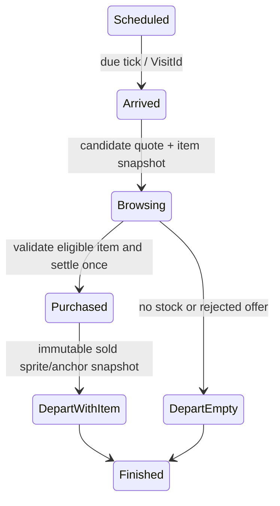

# Showroom and economy audit

## Approved decision

Fixed reusable display slots, individual weapon sprites, visible browsing/decision/carry-out, held/reserved goods, capacity purchased from Carpenter. No unique room background per weapon. Finite storage is not a promise of finite lifetime income.

## Existing implementation

`showroom.rs:8` has Empty/Reserved/Displayed(Good)/Held(Good), `:49` proposes 4/6/8 slots and three racks, `:154` reserves one result slot, `:178` sells first displayed good (legacy overflow first). `lib.rs:360` settles the purchase immediately at next_visitor, first tick 12 then 18–30 seconds using saved RNG. No purchase rejection except no sellable stock, no customer preference/budget/price policy. `presentation.rs:17` enqueues only already-committed Sold; phases Enter <0.5s, Walk <3s, Inspect <4s, Purchase <4.5s, Exit until 8s. Its pop discards the event payload, so it cannot carry a specific crafted weapon after state removal. Existing sprite path is the same generic dagger, not selected instance.

`spaces.rs:845` renders current racks/slots and selected detail; `village.rs:812` sells furniture through core commands. `weapon.rs:280` separately sells a crafted hunting knife immediately for 4G. These paths must converge on shared item identity, never duplicate one weapon into showroom stock. `showroom.rs:220` inserts slots during upgrades; index-based UI selection can drift to another item.

## Proposed event/state machine

Prefer deterministic domain visitor schedule and explicit one-time decision with a presentation snapshot. A fully presentation-owned buy callback is rejected because hidden windows/offline animation cannot settle correctly.

Proposal: domain phases use logical ticks with versioned durations; visual clips interpolate between them. Browse selection does not reserve the item against player decisions; at purchase, revalidate sale eligibility/price. If player holds or lends it meanwhile, visitor departs without buying (no substitute item surprise). Alternative exclusive browse reservation prevents races but makes player controls unexpectedly unavailable; defer. Price and outcome policy D07 must be approved; do not add a probabilistic rejection curve implicitly.

Events `VisitArrived {visit,npc}`, `VisitBrowsing {visit,item?,quote}`, `VisitResolved {visit,outcome,snapshot?,gold}`, `VisitDeparted` reference stable IDs. Atomic purchase removes the instance from ownership/location and credits gold once, stores terminal disposition/history and immutable `ArtId,appearance,grip_anchor` payload. Presentation never looks up a now-deleted item or changes inventory. Reopening/restarting acknowledges latest relevant event without replaying all catch-up visitors. Proposed online presentation queue cap 8, excess summarized; this drops animations, not purchases. Offline still uses authoritative visitor resolution within existing 8h cap. Show rejected/no-stock departures honestly; no forced celebration.

One logical object per slot regardless of silhouette size. Render art preserving aspect/pivot in 64×64 slot, 96×96 detail; bow/polearm may use a larger inspect area without using extra storage slots. Carried art uses grip socket and native integer scale, never stretch to hand. Entrusted/reserved/lent items are not sellable. Show selected ID and reason for unavailable actions. Racks grow the same shell; stable SlotId prevents upgrades from redirecting selection.

### Measured rules, calculated economy

Current `BuyOre` is 4G/2 ore; ordinary dagger costs 2 ore and sells 12G, gross material margin **8G** before food. Healthy 5s crafting is faster than 18–30s visitors; with continuous supply visitor throughput is at most 200/hour, at least 120/hour from interval bounds, about 150/hour only if residues behave uniformly. Expected-margin illustration at 24s interval is **1200G/hour**, not a measured sustainable playthrough; finite 32-job queue, stock, rest and player purchasing constrain it. Queue does not refill itself.

Farmer net on-time margin is 20G for 20 effective seconds; late 8G. Chef is also 20G margin once. Both are one-off, whereas design calls routine repair primary income every 30–60 minutes. That cadence yields much lower potential income than continuously replenished visitor daggers at current accelerated timings. State the mismatch; do not claim balanced cozy economy from tutorial timings.

Rack full expansion from one tier-1 rack to three tier-3 racks costs **240G + 26 timber**: two purchases at 30G/4 wood, three upgrades at (20+40)G/(2+4) wood. Timber at 3G gives total purchased-input opportunity cost **318G**. Capacity improves burst storage, not sale frequency. Current trade stock starts timber40/leather30/staples60/meals12 with no restock (`village.rs:140`), so recurring economy is not indefinitely sustainable. Food2G, meal9G, research new total186G and party fee TBD are available/planned sinks; arbitrary fee additions cannot solve the missing loop.

Crafted knife sale at4G is a disposal price: Iron Quick ore cost4G breaks even before work, Steel Careful ore cost8G loses4G. Treat 12G generic dagger versus4G crafted knife as explicit legacy balance, not a quality-derived market. D07 must choose one recommended-price table and whether optional player price adjustment is deferred; ECONOMY.md already records that direction, so deferral needs explicit approval.

Required balance evidence: 30/60/120-minute deterministic sessions for routine-repair-first and sales-first; zero-gold recovery; zero ore/wood; all-root research spender; failed expedition twice; full held inventory; no auto-purchases; shop stock exhausted. Report gold sources/sinks, work utilization, queue idle time and next attainable action. No claims of fun from simulation alone; follow with owner playtest.

## Open decision

D07: price/rejection/visitor pacing, online browse durations, manual price scope; D02: repeat income, merchant restock, recovery; D05: shared identity with existing separate storage budgets and container-specific return reservations. Reuse #92/#93/#95 for ownership/capacity/sales and #112 for presentation. Existing sale animation is implemented but incomplete for this design.

## Explicitly excluded scope

No demand simulation, NPC economic agents, per-weapon backgrounds, automatic replenishment, baseline alteration or gameplay tuning in this audit.
