# Atlas v1: 75% smiths and runtime depth review

## Build and scope

Implementation on `feat/unified-workshop-flicker`, based on `ae47fc5` (PR #123).
At inspection main was `e541524`; #122 and #123 were already merged, but #123 had
been merged into the old feature branch (`96c9d9d`), not main. The new delivery
includes that dependency without rewriting or merging someone else's branch.
`source-sha256.json` pins the runtime source, fixture exports and captured binary.
Canonical character source and core/save files remain unchanged.

[Layout, source audit, old/new positions and contact/depth contract](../../../design/WORKSHOP_ATLAS_V1.md)

## Evidence types

**Offline composites:** `composites/` uses the actual repository frames, the new
fixture layers and background. It includes logical 960×180 PNGs, exact nearest
4× enlargements, six-frame GIFs and exact/snapped contact positions. These are
not runtime screenshots. Twelve ZIP character references matched current source
pixels exactly after 3/4 reduction (`input-audit.json`).

**Bevy runtime:** `runtime/` contains actual macOS Metal GPU readbacks at 200% DPI
(1920×360 or 1920×1080). `-logical.png` files are nearest 2:1 reductions for the
960×180/540 logical view; `-4x.png` files enlarge that logical view with nearest.
Sequence GIFs assemble six real captured frames at an inspection cadence. They
are not continuous screen recordings or frame-pacing measurements.

**SpriteFusion:** OAuth succeeded; tool listing and private input upload succeeded.
See `spritefusion-tools.json` and `spritefusion-upload.json`. No placement/layer/
project-export tools are exposed, so there is no claimed SpriteFusion layout
screenshot or editable SpriteFusion project. Editable source is the PNG atlas,
its back/front layers and `assets/forge/atlas-v1/layout.json` (Little Forge format).

## Runtime gallery

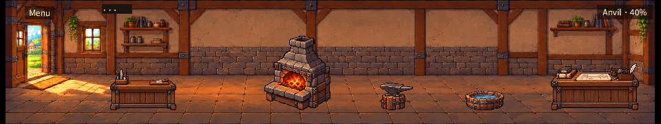
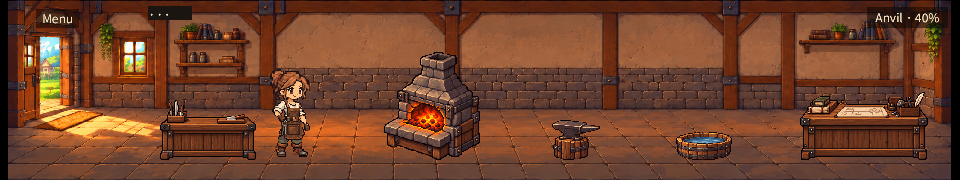
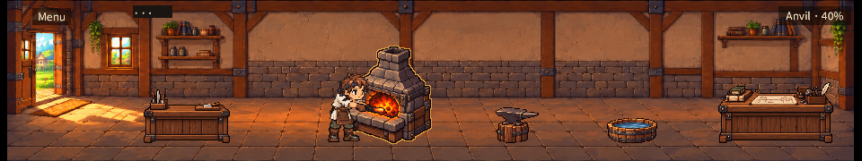
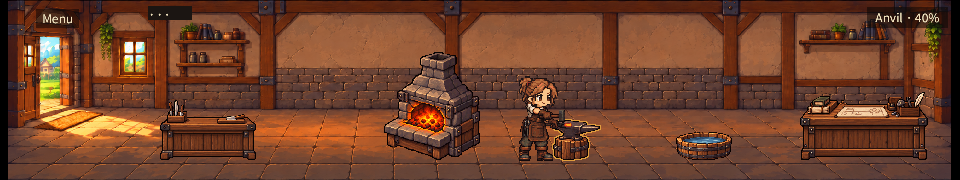
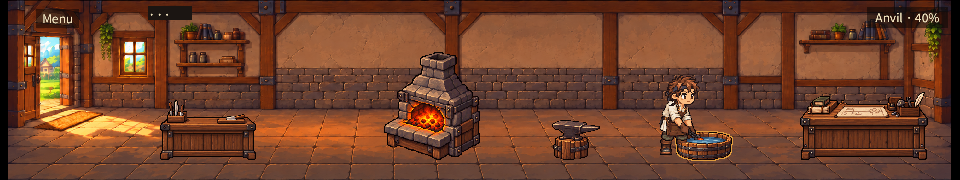
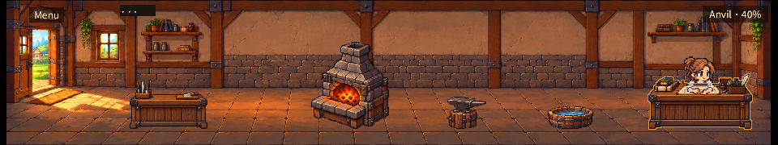
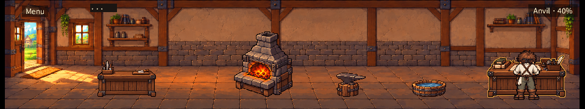
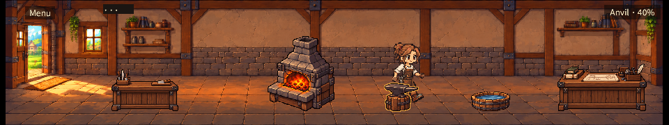
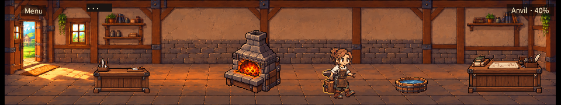
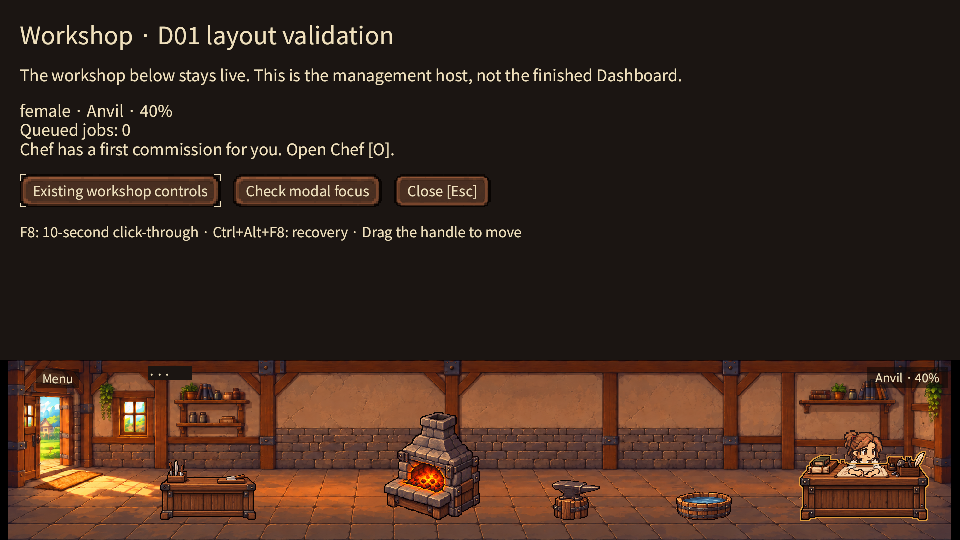
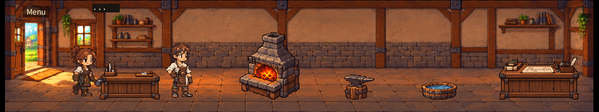

Both sexes have all five work poses, idle, empty, overlap and front/back walking
captures. Desk and walk GIFs show multiple frames, including the tub crossing.
Research/salvage are pose fixtures, not gameplay completion. The HUD in these
fixtures may report the independent underlying Anvil/Quench simulation stage.

## Verification

- fmt check, clippy with `-D warnings` and **104 workspace tests passed**.
- Existing character animation validator passed; canonical source is unchanged.
- Atlas exporter check passed: binary alpha, exact back/front reconstruction,
  cached silhouette masks and deterministic full-canvas 3/4 derivatives.
- Both smiths passed **100 native window cycles each** with real paid Chef work,
  stable actor/fixture identity, heating/hammering/quenching and save/load equality
  during work and at end. Compressed reports are included.
- Real Craft/scheduled sale using an explicit migrated-recipe fixture: sold=1,
  gold=12, zero sellable goods, save/load equality. No injected sale event or
  altered economics. This is not new-game recipe unlock evidence.
- Resize geometry: 1,402 samples, 101 opens, 101 closes, 900 visible-host samples,
  **zero unsafe visible samples**. First transition frames and raw traces included.
  Geometry checks do not prove every physical-monitor frame was inspected.
- Research lower-body mask check: zero uncovered pixels in bottom 30 logical
  canvas rows, both sexes × six frames. Runtime screenshots separately confirm
  visible hands/upper body and the solid front; the mask test alone is not approval.
- Actual macOS mouse/keyboard: isolated new game → Eira → new room/Farmer;
  silhouette anvil selection, transparent-padding rejection, Tab/Esc expansion
  and collapse, modal consumes underlying anvil click then restores focus.
  CUA showed the same rendered room; CUA images were reviewed in-session.

Core offline/save regression unit tests passed. A fresh process restart during
active work, Windows/Shadow PC, other DPI scales and global recovery/drag were
not requalified in this pass. No CI thresholds or golden images were changed.
CI results belong to the new PR, not the parent tests or these local logs.

## Reproduce

Use fresh isolated save directories. Pillow is needed for exports/composites.

```sh
python3 scripts/export-workshop-atlas.py --check
python3 scripts/preview-workshop-atlas.py
python3 assets/characters/qa/verify-animation.py
cargo fmt --all -- --check
cargo clippy --locked --workspace --all-targets -- -D warnings
cargo test --locked --workspace
cargo build --locked -p little-forge
LITTLE_FORGE_INTERIOR_POSE=researching target/debug/little-forge --qa forge-interior-female --screenshot /tmp/atlas-research.png --save-dir /tmp/atlas-research-save
target/debug/little-forge --qa d01-female --screenshot /tmp/atlas-female.png --save-dir /tmp/atlas-female-save
target/debug/little-forge --qa d01 --screenshot /tmp/atlas-male.png --save-dir /tmp/atlas-male-save
target/debug/little-forge --qa d01-sales --screenshot /tmp/atlas-sale.png --save-dir /tmp/atlas-sale-save
```

Pose names: forging, hammering, quenching, researching, salvaging, idle, empty,
overlap, walk-front, walk-behind. Use `forge-interior` for male and
`LITTLE_FORGE_INTERIOR_EXPANDED=1` for the upper host. Frame captures occur at
35/55/75/95/115/135. For resize evidence set `LITTLE_FORGE_TRACE_DIR` and
`LITTLE_FORGE_RESIZE_CAPTURE_DIR`, then run `scripts/verify-d01-resize.py`.

## Owner review remains necessary

Review hand/tool contact across all motion frames, the floor spacing and apparent
prop size at 960×180. The legacy sale visitor's fixed 1/3 source-density conversion
before 0.75 display is explicitly a review item. It does not change smith scale.
The background keeps the existing 8/9px side margins. Furnace flame art is static.
No live PNG-only hot reload, measured GPU frame cost, general pathfinding or
complete Showroom/Dashboard interface is claimed. Do not close visual acceptance
issues or begin Dashboard from passing tests alone.
