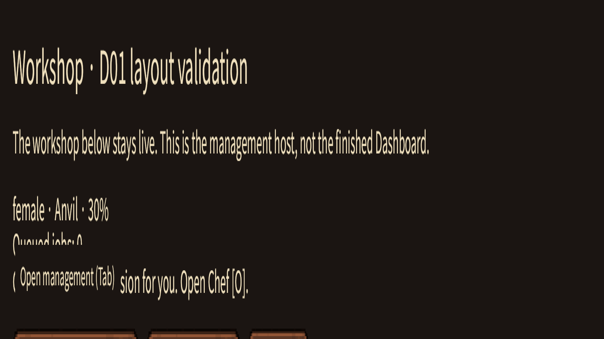
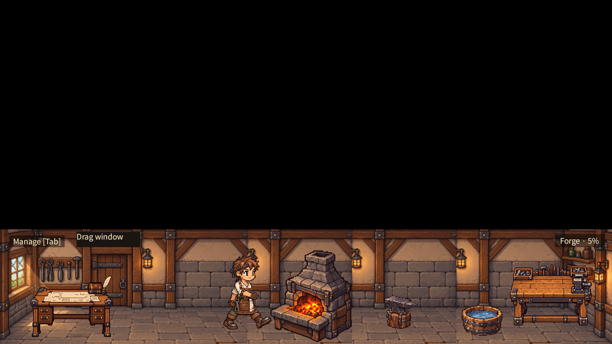
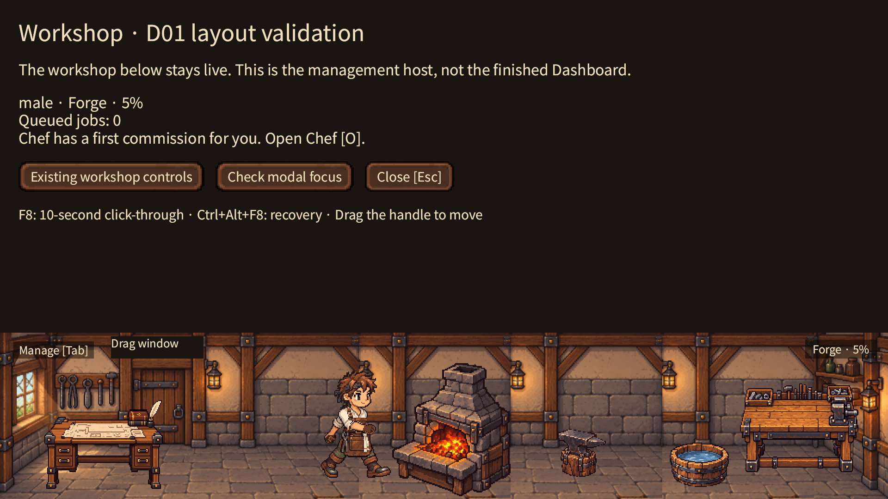
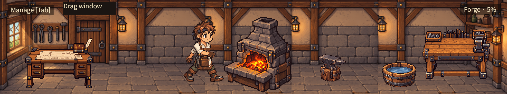

# D01 resize/layout synchronization

2026-10-19. PR #122 base: `ff475ba18d9abf0e72824be9749532cf5bd0cb78`.
Latest fetched main: `6677dca75bd012dcc05e1dc485f3900673044ada`.
This patch changes only viewport synchronization, host visibility/focus, diagnostics and regression coverage. No artwork, Showroom, economy, save schema or simulation changes are included.

## Confirmed cause

The native resize request and the camera/UI projection were one frame apart.
`window::update` changes `Window.resolution` in Update. Bevy 0.20 Winit applies that request and emits `WindowResized` in Last, **after** camera projection and UI layout in PostUpdate. Bevy's `camera_system` does not refresh just because Camera is changed: it checks resize messages, projection changes and viewport **size**. The persistent world viewport remains 960x180 when its origin moves, so changing its position does not trigger that refresh either.

The original host becomes Display::Flex immediately from `shell.expanded`. Consequently, the expanded render target could use the old compact projection, stretching the host over the workshop. This is independently reproduced by a headless test invoking Bevy's actual camera system without a native resize message. Removing the projection invalidation makes it fail with actual target 960x180 versus expected 960x540. See [negative test](resize-regression-negative.log).

At Retina 2x, the diagnostic run recorded:

| Transition frame | Requested window | Native inner size | Camera target before fix | Fixed host |
| --- | --- | --- | --- | --- |
| Expand request | 1920x1080 | 1920x360 | 1920x360 | Hidden, layout active |
| Native acknowledgement | 1920x1080 | 1920x1080 | 1920x1080 | Visible at y=0..720 |
| Collapse request | 1920x360 | 1920x1080 | 1920x1080 | Hidden |

The mismatch was confirmed in the diagnostic intermediate run, not inferred from a black screenshot alone.

## Fix

1. When requested physical window size differs from a camera's computed target, mark its Projection changed before Bevy's camera system. Both cameras receive current coordinates in the same PostUpdate. The existing cameras and world entities remain alive.
2. Keep the requested host in layout, but start with Visibility::Hidden. After UiSystems::Layout and before visibility propagation, require native inner size, Bevy window size, both camera targets, bottom viewport, host size and host center to agree with the expanded geometry.
3. Publish host visibility only when those conditions hold. A collapse hides it immediately. Focus restoration follows actual publication instead of the expansion request.

There is no timer, sleep, fixed frame delay, disabled animation or screenshot substitution. The four-frame diagnostic capture burst is observation only; it does not control rendering.

## Native and automated evidence

Apple M4, macOS Metal, scale factor 2.0. The isolated run uses **PR #122's original room and assets plus this patch**, excluding the separately retained unified-room work.

- Production `--qa d01`: 100 rapid expansion/collapse cycles during real paid Chef crafting; lifecycle result passed through heating, hammering, quenching, rest and saved state checks. Same actor identity is retained. [Full lifecycle evidence](lifecycle.json.gz).
- 1,401 geometry samples, 101 opens/101 closes including setup/final navigation, 900 visible host samples, **zero visible samples with unsafe native/window/camera/host geometry**. [Trace](host-layout.jsonl.gz).
- 410 native Bevy GPU transition captures. The selected first frames below were visually inspected. All transition captures were also screened for the host's opaque surface color in the bottom 360 physical pixels: zero matching pixels. This is a focused overlap check, not a replacement for visual acceptance. [Capture hashes](capture-sha256.json).
- A separate female run on the retained integration working tree also completed 100 cycles: 652 samples, 101 opens/closes, zero unsafe visible samples. It is supplementary evidence, not the isolated PR qualification.
- Actual macOS CUA input on that integration build: Continue, Tab expansion, modal button, Tab within modal, Esc dismisses only modal, second Esc collapses. Stable OS captures showed the host above the workshop. GPU captures recorded the first transition frames. CUA snapshots alone do not establish every OS compositor frame.
- `cargo fmt --all -- --check`, `cargo clippy --locked --workspace --all-targets -- -D warnings`, and `cargo test --locked --workspace`: passed on the isolated patch; **99 tests**. [Test log](resize-tests.log).
- No golden baseline or threshold changed. Before this patch, PR #122 had Ubuntu/macOS green and Windows/Visual red. New commit CI must be assessed separately.

## First-frame comparison

The before image is an earlier ff475ba female run; the isolated after images use the male smith. The comparison concerns projection/host placement, not character artwork.

Before: host stretched over the whole expanded target:



After, first expansion frame: host withheld, workshop already in its correct bottom viewport:



After native acknowledgement: host occupies only the upper 360 logical pixels:



First collapse frame: normal-size workshop, no host:



[Later expansion during work](after-expand-later.png) confirms this is not only a startup correction.

## Reproduce

Run from a built repository on a native desktop, using an isolated save directory:

```sh
mkdir -p /tmp/d01-resize-evidence
LITTLE_FORGE_TRACE_DIR=/tmp/d01-resize-evidence \
LITTLE_FORGE_RESIZE_CAPTURE_DIR=/tmp/d01-resize-evidence \
cargo run --locked -p little-forge -- \
  --qa d01 --save-dir /tmp/d01-resize-save \
  --screenshot /tmp/d01-resize-evidence/result.png
python3 scripts/verify-d01-resize.py /tmp/d01-resize-evidence
```

Repeat with `--qa d01-female`. For real Tab/Esc input, omit `--qa` and Continue the isolated save. Host logs are written after layout/before visibility propagation. Screenshot filenames identify the request frame; GPU readback callbacks complete asynchronously. Check the captured dimensions alongside the trace instead of assuming callback time is presentation time.

Full local frame sequences: `/private/tmp/little-forge-unified-evidence/resize-isolated` and `resize-synchronized`. Only representative PNGs and the complete trace/hashes are committed.

## Qualification boundaries

This resolves the reproduced host-over-workshop transition on the tested macOS configuration. It does not certify every OS-compositor frame, other DPI configurations, Windows native behavior, or unrelated earlier all-black capture reports. Those are not attributed to this cause without evidence. Fullscreen/undersized layouts and per-pixel passthrough remain outside this patch. The newly composed room, its transparent roof margin, and integrated Showroom remain separate unapproved work. PR #122 remains unmerged and requires CI and owner review.
