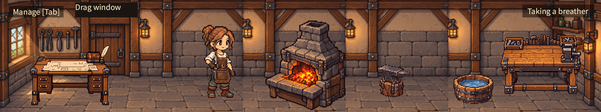
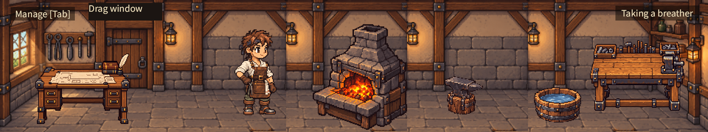
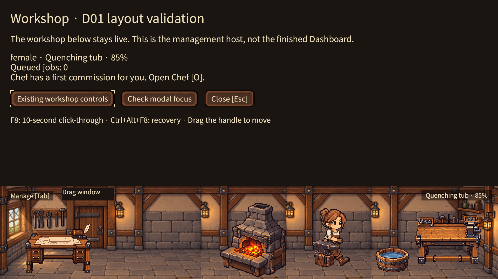
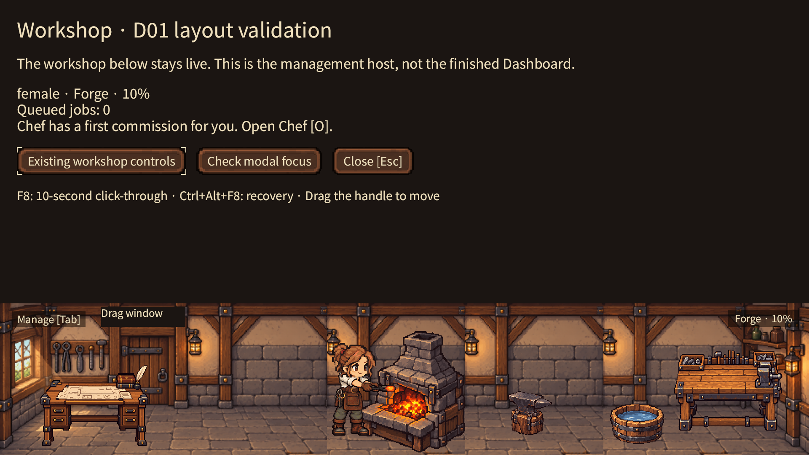
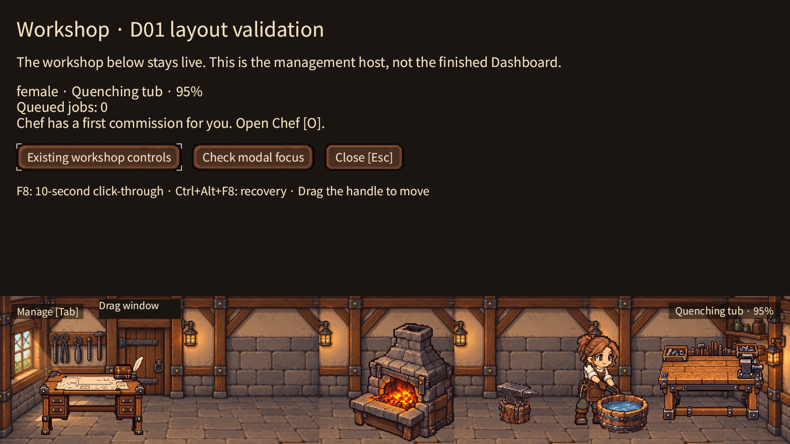
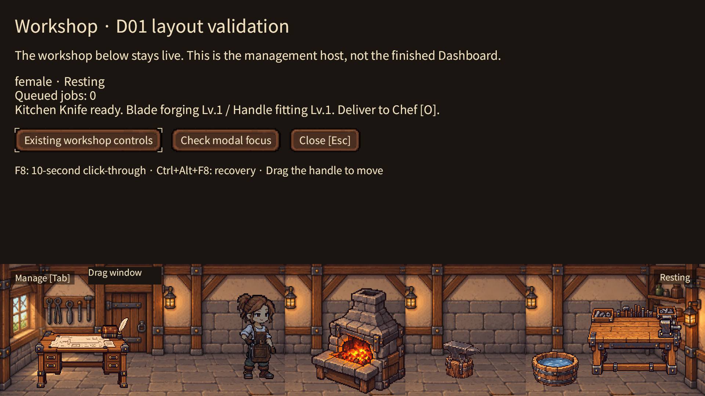
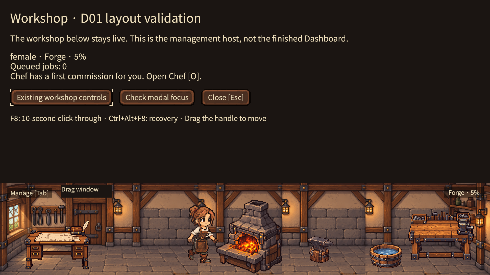

# Actual Bevy evidence

See [runtime review](../../D01_RUNTIME_REVIEW.md) for reproduction and qualification limits. These PNGs are actual macOS Metal captures at 200% DPI, using the production ECS scene and deterministic QA clock. These reviewed images precede the final legacy-scroll/tab-group adjustment. Final-build captures after the native tool failure were black and are NOT accepted evidence; see `blocked-final-black.png`. No native recording was obtained.

