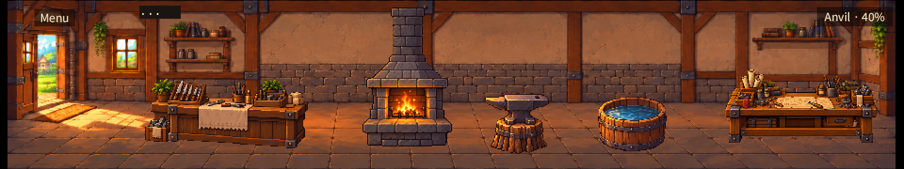
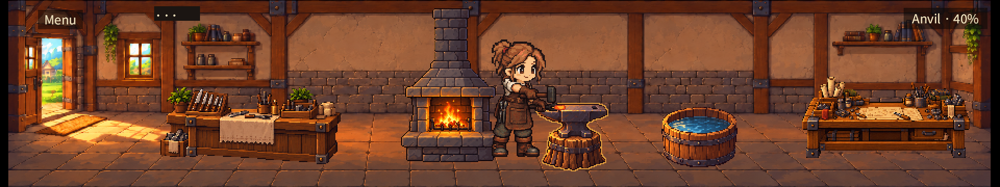
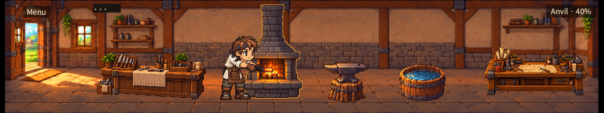
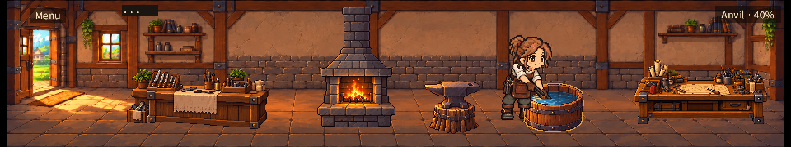
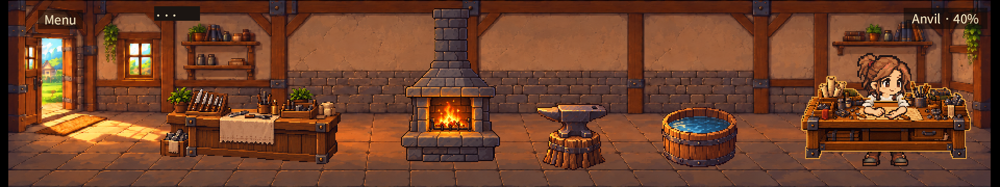
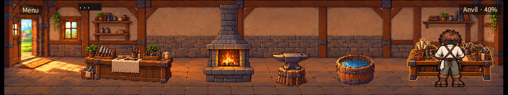
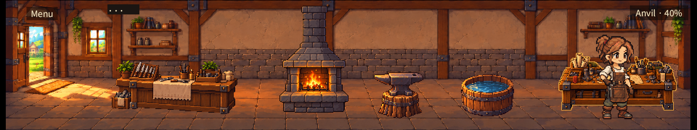
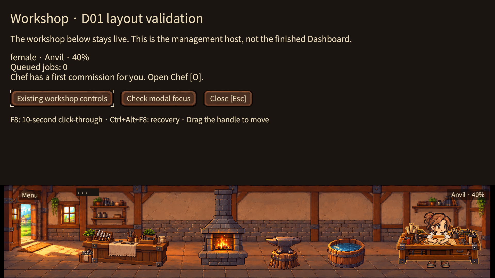
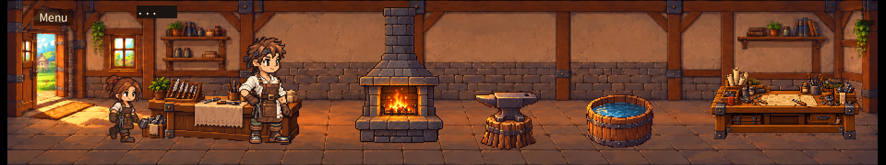

# Supplied interior: macOS runtime evidence

Captured 2026-10-19 from the implementation working tree based on PR #122
`70ea31509abe1cdb427fc548bbf4946d86264348`; fetched main was
`6677dca75bd012dcc05e1dc485f3900673044ada`. `source-sha256.json` pins code/assets
and executable used for these captures. No golden baseline was changed.

## Review images

All PNGs are actual Bevy Metal GPU readbacks at native 200% DPI, not concept art.
The logical ambient area is 960×180; screenshots are 1920×360. Expanded captures
are 1920×1080. View at 50% for logical size, or 100% for physical pixels.











Both sexes have matching forging, hammering, quenching, research, salvage, overlap
and empty captures. Research/salvage include frames 35, 75 and 115 to inspect hands
and occlusion across the clip. These are isolated pose tests: the core fixture's
Anvil 40% HUD is intentionally independent of the forced pose. They do not prove
research/salvage gameplay. No salvage command was introduced.

## Results and evidence boundaries

- Rust fmt, clippy with `-D warnings`, and all 103 workspace tests passed.
- Deterministic export check and existing animation validator passed; logs included.
- `female.png.json.gz` and `male.png.json.gz`: 100 expansion/collapse cycles each,
  persistent actor/fixture identities, real paid Chef crafting through heating,
  hammering and quenching. Save/load equality during work and at end passed.
- `sale.png.json.gz`: migrated-recipe fixture, real paid Craft command and scheduled
  sale, sold=1, gold=12, no remaining sellable good. Save/load equality passed.
  This does not represent a new-game recipe-unlock acceptance test.
- `resize-result.json`: 1,402 native geometry samples, 101 opens and 101 closes,
  900 visible-host samples, zero unsafe visible samples. Compressed raw trace is
  included. First transition PNGs are included separately. Geometry assertions
  are not a pixel-by-pixel proof of every frame on the physical monitor.
- Actual macOS CUA mouse/keyboard session on the same binary: five fixture clicks,
  furnace deselection, transparent anvil padding ignored, Tab expansion, modal
  blocking of underlying furnace clicks, Esc modal dismissal then collapse.
  CUA showed the same room. Its images were reviewed in-session, not saved here.
- Current core/character source files are unchanged. No new save schema or economy
  rules. Reload equality is tested; a separate process restart and fresh offline
  catch-up native run were not repeated in this milestone.

`capture-sha256.json` indexes the full local frame set. Selected PNGs and compressed
traces are committed; uncommitted frame sequences remain at
`/private/tmp/interior-evidence/current` for local review. No screen recording is
claimed. Windows/Shadow PC, other DPI scales, dragging and global F8 recovery were
not newly qualified. Registration success in a log is not global recovery proof.

## Defect found during integration

`before-legacy-animation-moved-furnace.png` preserves the failed first run. The
generic legacy `animate` Sprite query included the new fixture entities and moved
the furnace. Excluding `FixturePart` and `ResearchArms` fixed it; a regression test
checks that generic animation does not alter fixture transform/visibility. This
is separate from PR #122's earlier window/projection synchronization fix, which
is retained unchanged. The before image also uses the previous local backdrop.

## Reproduce

From repository root, use an isolated save directory for every run:

```sh
cargo fmt --all -- --check
cargo clippy --locked --workspace --all-targets -- -D warnings
cargo test --locked --workspace
python3 scripts/export-interior.py assets/forge/interior/source --check
cargo build --locked -p little-forge
target/debug/little-forge --qa d01-female --screenshot /tmp/interior-female.png --save-dir /tmp/interior-female-save
target/debug/little-forge --qa d01 --screenshot /tmp/interior-male.png --save-dir /tmp/interior-male-save
target/debug/little-forge --qa d01-sales --screenshot /tmp/interior-sale.png --save-dir /tmp/interior-sale-save
LITTLE_FORGE_INTERIOR_POSE=researching target/debug/little-forge --qa forge-interior-female --screenshot /tmp/interior-research.png --save-dir /tmp/interior-research-save
```

Pose names: forging, hammering, quenching, researching, salvaging, overlap, empty.
Use `forge-interior` for male; `LITTLE_FORGE_INTERIOR_EXPANDED=1` opens the QA host.
For transition traces, set `LITTLE_FORGE_TRACE_DIR` and
`LITTLE_FORGE_RESIZE_CAPTURE_DIR`, then run `scripts/verify-d01-resize.py` on the
trace directory. The trace frame counter requires a QA run, not ordinary play.

## Remaining visual and delivery gates

- Full-room export uses 943×180 content inside 960×180, with 8/9px transparent side
  margins. Owner approval is required for this framing, pixel density and contacts.
- Counter knives baked into the supplied art are decorative, not inventory.
  Four independent runtime sale icons reflect actual displayed slots. An empty
  counter derivative remains necessary if every pictured knife must be stock.
- Furnace fire in the supplied fixture is static artwork. Character work motion
  remains animated; new environment flame animation is not implemented.
- Exact hit masks and outline assets require export plus restart after art edits.
  PNG-only live reload is not supported/qualified by this feature configuration.
- Memory estimate: fixture layers/outlines 800,160 decoded RGBA bytes, all 24
  research arm overlays 1,966,080 bytes. These are asset-size estimates, not measured
  frame pacing, draw calls or GPU residency.
- Current baseline PR #122 CI: Ubuntu/macOS success; Windows and Visual failure.
  This integration has separate CI status. No failing gate is waived here.

Do not merge or declare final visual acceptance from the automated results alone.
The next step is owner review of both smiths at all five fixtures, then remaining
platform/input qualification. Dashboard work has not begun.
