# Epic 58 integration review — 2026-10-17

> **Screen audit supersession (2026-10-19 UTC):** Current manifest has47 files (19 controls+24 icons+4 headers), not48. Exports and scrollbar/modal sprites exist, but visual approval remains pending. Earlier absent-export statements below describe older work, not latest main. [Current audit](../design/ASSET_PRODUCTION.md).

Status: **draft; epic and children remain open**. This branch adds shared Bevy
widgets and runnable game windows, but it does not satisfy the mandatory art-first
export gate. No issue is auto-closed by this PR.

| Issue | Implemented / evidence | Remaining acceptance |
| --- | --- | --- |
| #59 | Source provenance/hashes, inventory, proposed native sizes, temporary crop/inset contract, licensed font manifest | Validated runtime manifest after exports |
| #60 | Nine-slice window/inset and five button states in real Bevy | Independent native RGBA controls, tabs, slots, scrollbar, separators; 1x/2x seam/halo review |
| #61 | Named 24-icon crops, four backgrounds, separate existing NPCs; ASCII + 11,172 Hangul glyph coverage | Independent registered transparent icon/header exports and native-size approval |
| #62 | `forge-ui` + independent `ui-preview`, fixtures/capture runner, focus/hover/pressed/disabled and modal | Art gate; exhaustive pressed/focus visual evidence |
| #63 | One village/management root, hidden ledger, ambient return, modal guards, semantic focus restoration | Native platform visual approval; art gate |
| #64 | Crafting/materials/provisions, actual queue/time/progress/needs and supported commands | Native slot art; final visual approval |
| #65 | All real catalog entries, selected item, quantity/stock/owned/total/disabled reason, four NPC headers | Art gate and final visual approval |
| #66 | Larger uncropped canonical map, existing hit regions, compact navigation, unsupported destinations | Final narrow/DPI visual approval |
| #67 | Tooltips, status, reusable confirmation with focus return; existing title controls share skin | Final shell dialog typography/visual review; shell features remain #35 |
| #68 | Rust regressions, actual Bevy capture scripts, OS input checks, CI/package wiring | Native macOS/Windows jobs not run locally; art gate blocks final acceptance |

## What changed

`forge-ui` owns shared panel/button/item/progress/header/tooltip/modal builders,
colors, optional font loading and keyboard focus. Preview depends on this crate,
not game simulation. Desktop delegates UI presentation to it while existing
`State::command` remains the transaction authority. Duplicate IDs, hidden-screen
commands and active-dialog purchases remain guarded. Confirmations resolve once;
Escape chooses cancellation, with Cancel as the initial focus.

A font-loading lifetime bug was fixed: the font handle is held as a resource even
before it finishes loading. Missing optional art leaves opaque panels and live
labels. NPC identity files and approved map artwork were not regenerated.

The title/load/settings/quit state machine and save format are unchanged; the
shared button skin is attached to the existing controls. No save-slot system,
research, commissions, expeditions, seeds or livestock was invented.

## Reproduction

```
cargo fmt --all -- --check
cargo clippy --locked --workspace --all-targets -- -D warnings
cargo test --locked --workspace
python scripts/validate-assets.py
python scripts/validate-village.py
python scripts/validate-ui.py
cargo build --locked -p little-forge -p ui-preview
xvfb-run -a python scripts/capture-village.py target/debug/little-forge
xvfb-run -a python scripts/capture-ui.py target/debug/ui-preview
xvfb-run -a python scripts/test-village-input.py target/debug/little-forge
xvfb-run -a python scripts/test-title-input.py
```

Extra desktop stories: `--safe-window --qa village-home|village-materials|village-provisions --screenshot PATH`.
`python scripts/validate-ui.py --release` deliberately fails while source-candidate
art remains. Passing hash and font tests is not native pixel-art certification.

## Environment and limits

Local actual-app evidence uses Linux X11/Xvfb, Vulkan llvmpipe, Mesa 25.2.8,
LLVM 20.1.2. This verifies application rendering and disposable X11 inputs, not
macOS/Windows transparency, native compositor behavior, physical monitors or
hardware GPU performance. CI retains those platform builds and publishes captures.
Generated source sheets have nonbinary alpha and are not native pixel exports;
noninteger display scaling is temporary. These facts block closing #58.

## Recorded local results

- `cargo fmt`, warning-free workspace Clippy and 45 Rust tests passed.
- Existing forge/village validators and UI source/font validation passed.
- Actual X11 map → carpenter purchase → farm purchase → tavern purchase → home
  → close passed. Domain tests cover duplicate-command rejection and modal guard.
- Actual title input passed: fresh title does not save; new game saves; F9 recovery;
  still-effects setting; Escape cancels quit; save-and-quit exits successfully.
- All 11 preview stories, 640×480, 200% X11 DPI and missing-art captures succeeded.
- All village destinations and missing map/NPC captures succeeded.
- Ambient and sale screenshots match existing baselines (changed ratio 0.0).
  The expanded baseline intentionally changes from the prototype ledger to the
  shared management screen; it is not used to approve unfinished source art.

Actual app screenshots, not generated mockups:

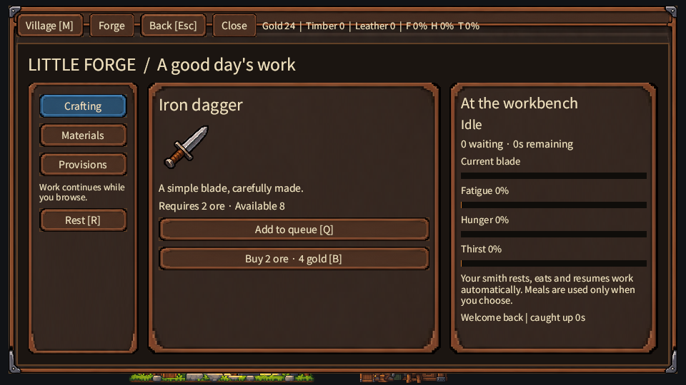
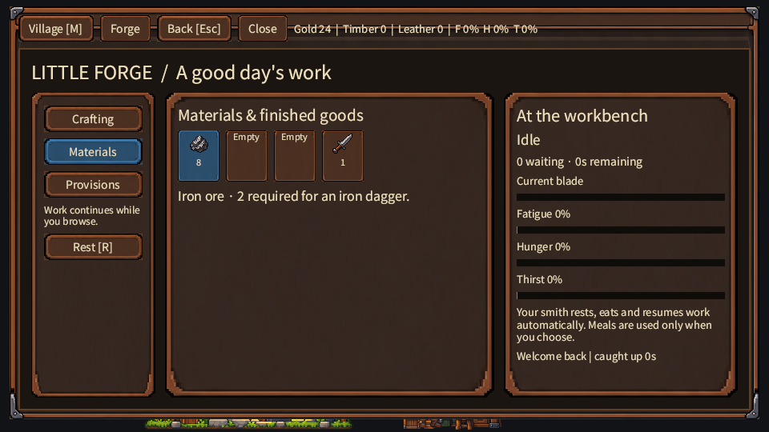
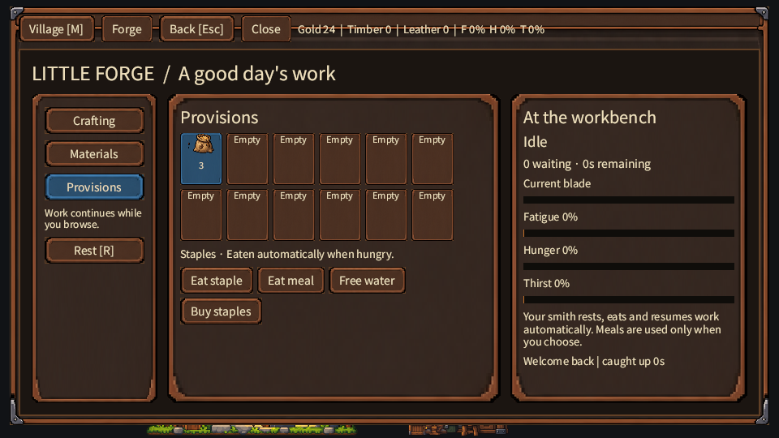
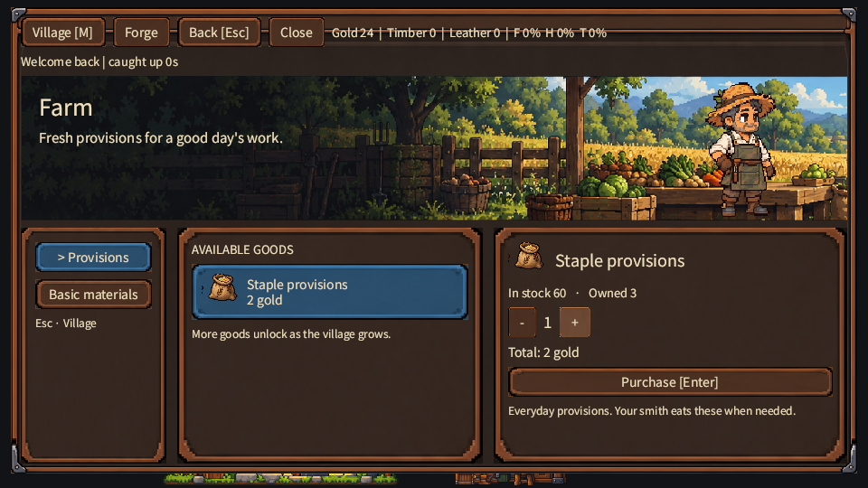
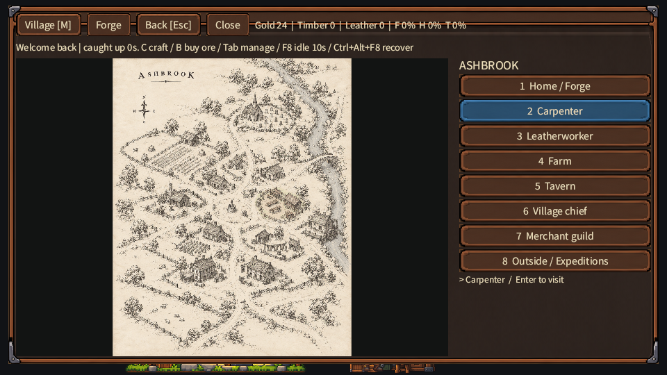
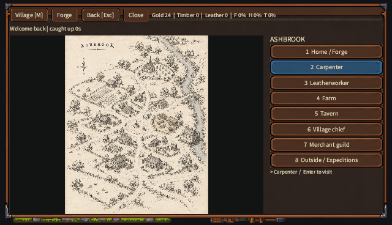

Shared-component preview fixtures:

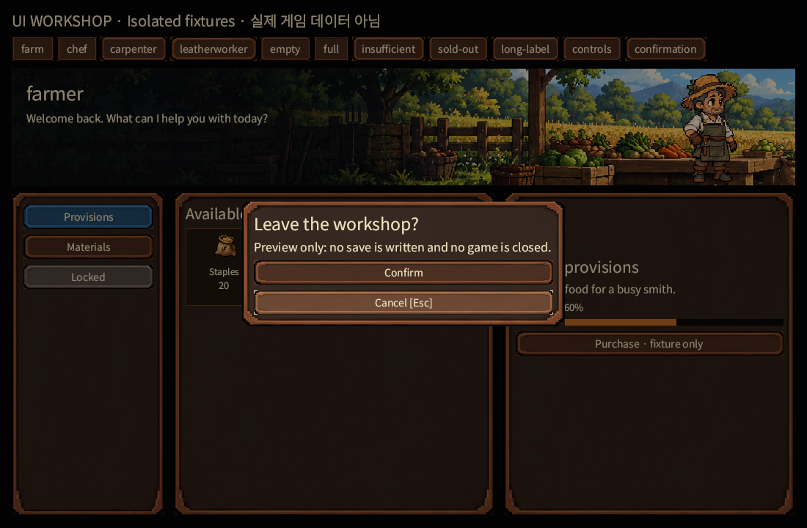
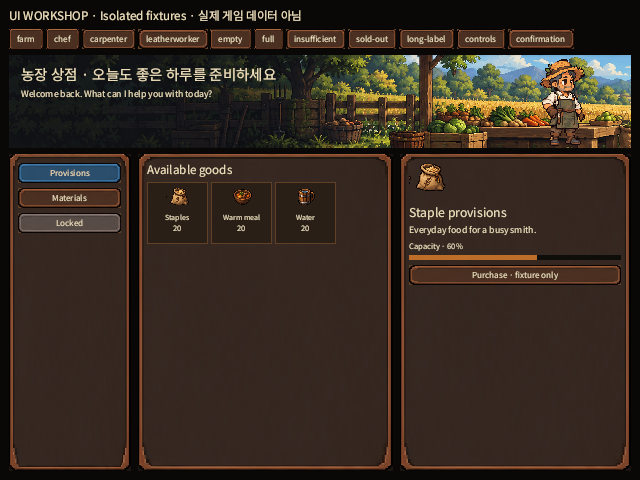
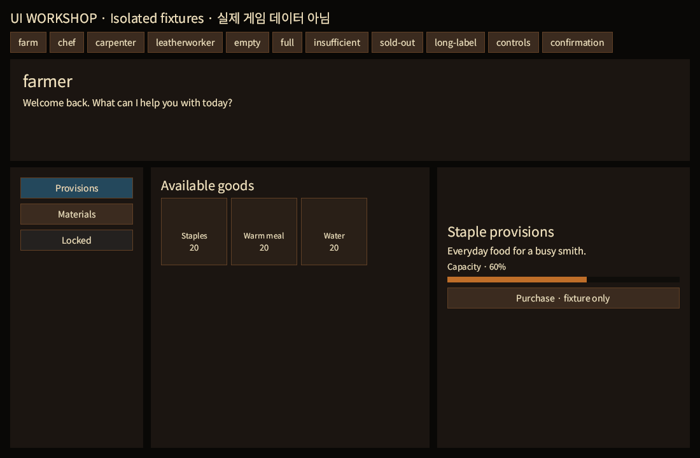

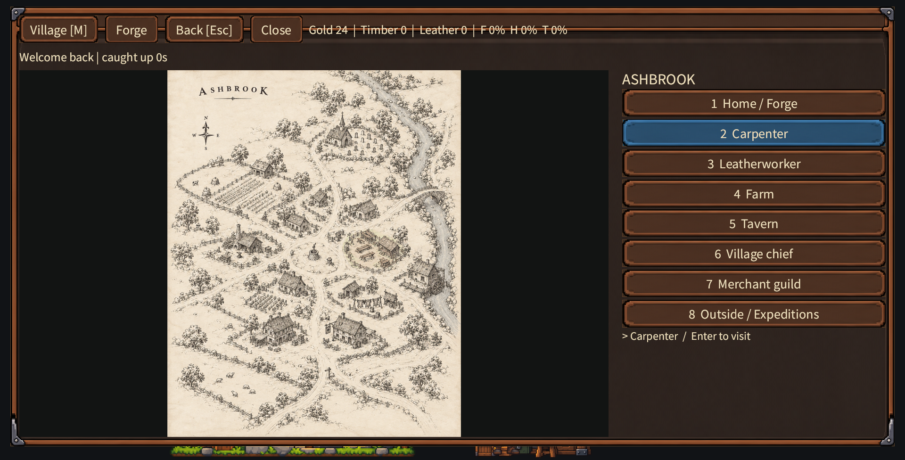

## Update 2026-10-18: true-pixel runtime exports

`forge-ui` no longer samples source-sheet rectangles. 48 independent files
(19 controls, 24 icons, 4 headers) live in `assets/ui/runtime/`,
snapped to a real pixel grid (see `assets/ui/README.md`) and verified by
`validate-ui.py`. Sidebar tabs, inventory slots and progress bars now use the
exported art; the farm header is undistorted with the farmer enlarged and in front
of the stall, cropped at the waist by the header edge.

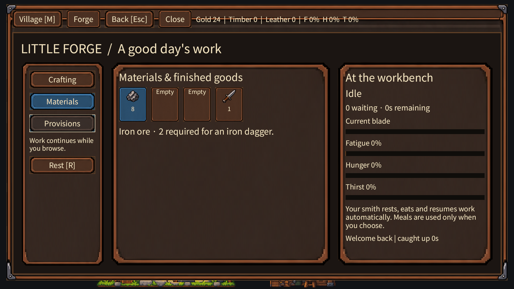
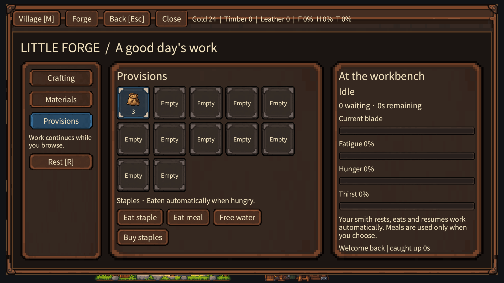
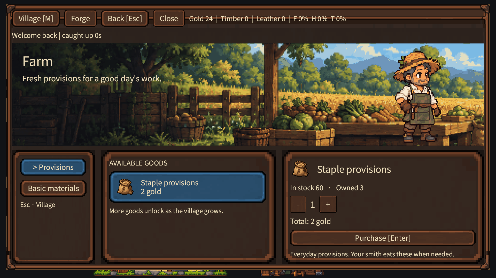
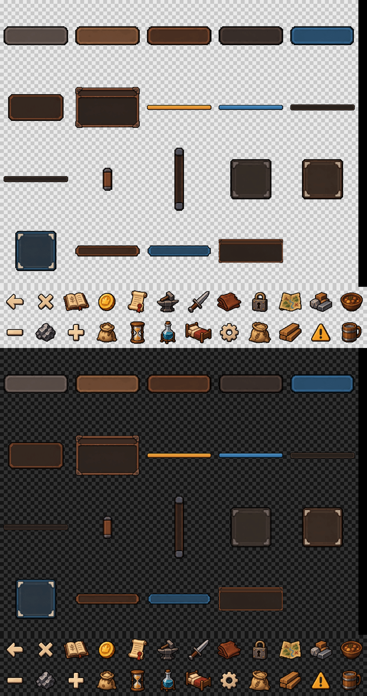

#59 (inventory, insets, provenance, font) and the export half of #60/#61 are done.
Still open: owner native-size approval, art for focus ring/separators, modal and
scrollbar components, restaging the other three merchants. No issue is closed by
this change.
